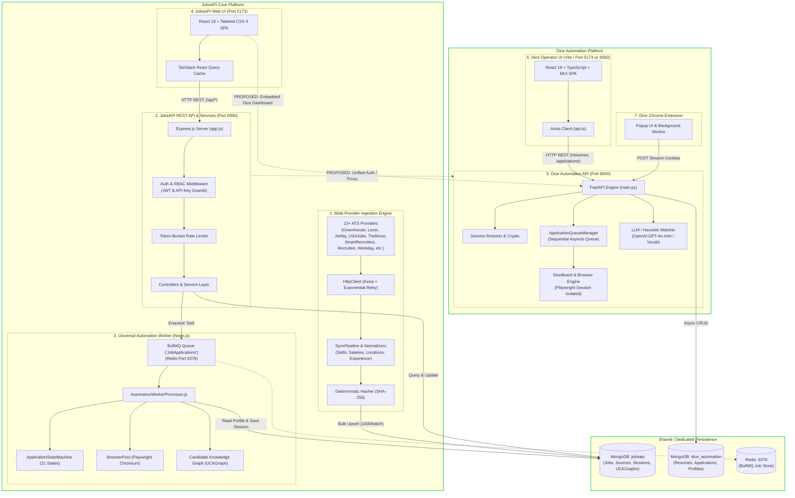

# 🏛️ Complete Monorepo System Architecture Specification

**Document:** Verified Monorepo Architecture & Cross-Application Dependency Mapping  
**Project:** JobsAPI Integration Platform  
**Audit Date:** 2026-10-10  
**Repository Branch:** `main`  
**Auditor:** Senior Staff Architect, Full-Stack Engineer, DevOps & Security Reviewer  

---

## 1. Executive Architectural Blueprint

The JobsAPI monorepo consolidates two distinct operational ecosystems comprising four applications:

1. **JobsAPI Core Ingestion & Universal Auto-Apply Platform:**
   * **Backend:** Node.js 22 + Express 5 + MongoDB + Redis (BullMQ) + Playwright Chromium.
   * **Frontend:** Vite + React 19 + Tailwind CSS 4 + TanStack Query 5.
   * **Primary Domain:** High-scale job ingestion across 13+ ATS providers, ATS-agnostic candidate profile governance (UCKGraph), and multi-provider robotic application worker.
2. **Dice Specialized Automation Platform:**
   * **Backend:** Python 3.11/3.12 + FastAPI + Motor (Async Mongo) + Playwright Chromium + OpenAI.
   * **Frontend:** Vite + React 19 + TypeScript 6 + Material UI (MUI).
   * **Primary Domain:** Dice.com authenticated session management, Dice-specific job discovery and applicant tracking, resume parsing/matching, and human-in-the-loop application review queue.

---

## 2. Actual System Architecture Diagram

---

## 3. Subsystem Breakdown

### A. JobsAPI Backend (`backend/`)

#### 1. Implemented Job Providers vs Documented Status
| ATS Provider | Implementation Status | Data Source Type | Auth Required | Fail-Safe Isolation |
| :--- | :--- | :--- | :--- | :--- |
| **Greenhouse** | ✅ Fully Implemented | Public Boards API (`boards-api.greenhouse.io`) | None | `Promise.allSettled` |
| **Lever** | ✅ Fully Implemented | Public Postings API (`api.lever.co/v0/postings`) | None | `Promise.allSettled` |
| **Ashby** | ✅ Fully Implemented | Public Job Board API (`api.ashbyhq.com/posting-api`) | None | `Promise.allSettled` |
| **USAJobs** | ✅ Fully Implemented | USAJobs REST API (`data.usajobs.gov/api/search`) | API-Key + UserAgent | `Promise.allSettled` |
| **TheMuse** | ✅ Fully Implemented | Public REST API (`themuse.com/api/public/jobs`) | None | `Promise.allSettled` |
| **SmartRecruiters**| ✅ Fully Implemented | Company Postings API (`api.smartrecruiters.com`) | None | `Promise.allSettled` |
| **Recruitee** | ✅ Fully Implemented | Offers API (`*.recruitee.com/api/offers`) | None | `Promise.allSettled` |
| **Workday** | ✅ Implemented Adapter | Public CXS Job Scraper Adapter | None | `Promise.allSettled` |
| **Jobvite** | ✅ Fully Implemented | Public RSS / XML Feed Parser | None | `Promise.allSettled` |
| **Teamtailor** | ✅ Fully Implemented | Public v1 API | None | `Promise.allSettled` |
| **BambooHR** | ✅ Fully Implemented | Public Embed API | None | `Promise.allSettled` |
| **Arbeitnow** | ✅ Fully Implemented | Public Job API (`arbeitnow.com/api/job-board-api`) | None | `Promise.allSettled` |
| **Remotive** | ✅ Fully Implemented | Public API (`remotive.com/api/remote-jobs`) | None | `Promise.allSettled` |

#### 2. Ingestion & Retrieval Pipeline Flow
* **Trigger:** Scheduled every 6 hours via `node-cron` (`src/cron/syncJobs.js`) or manually triggered via authenticated `POST /api/jobs/sync`.
* **Execution:** `sync.service.js` invokes `SyncPipeline` for each connector.
* **Network Layer:** `httpClient.js` wraps Axios with `axios-retry` (3 attempts, exponential backoff, circuit-breaker on 429/5xx).
* **Normalization:** 
  * Location normalized into city, state, country, and tagged with `isUSJob` and `jobRegion` (`Remote`, `Hybrid`, `Onsite`).
  * Text analysis extracts skills (`extractSkills`), annual compensation ranges (`extractSalary`), and seniority levels (`extractExperienceLevel`).
* **Deduplication:** Computes deterministic SHA-256 fingerprint:
  $$\text{jobHash} = \text{SHA256}(\text{company} + | + \text{title} + | + \text{location} + | + \text{jobType} + | + \text{source} + | + \text{applyUrl} + | + \text{descHash})$$
* **Storage:** Staged in `bulkWrite(batchSize = 1000)` operations using `upsert`. Unchanged jobs only update `last_seen`. Jobs unseen for 24 hours are flagged `is_active = false`.
* **Search & Retrieval:** `jobController.js` serves paginated, filtered queries with ReDoS-safe regex escaping (`escapeRegex`) and compound MongoDB indexing.

#### 3. Automation Worker Subsystem
* **Queue:** BullMQ queue `JobApplications` backed by Redis.
* **Worker:** `AutomationWorkerProcessor.js` processes jobs with concurrency limit 3.
* **State Machine:** Enforces strict linear progression through 21 validated states (`Created` -> `Queued` -> `WorkerAssigned` -> `LoadingProfile` -> `ValidatingProfile` -> `BrowserStarting` -> `BrowserReady` -> `OpeningJob` -> `AnalyzingPage` -> `AnalyzingForm` -> `ResolvingFields` -> `UploadingResume` -> `GeneratingAIAnswers` -> `FillingFields` -> `ValidatingFilledFields` -> `WaitingForUser` -> `ReadyForSubmission` -> `Submitting` -> `SubmissionVerification` -> `Completed`).
* **Browser Pool:** Bounded pool (max 5 Chromium instances) with isolated contexts per session, request timeouts, and `SIGTERM`/`SIGINT` process leak prevention.
* **Idempotency:** SHA-256 session idempotency fingerprint blocks duplicate application submissions within a configurable timeout window.

---

### B. JobsAPI Frontend (`frontend/`)

* **Initialization & Mounting:** Bootstraps via `src/main.jsx` wrapping the application in TanStack `QueryClientProvider` and `BrowserRouter`.
* **API Client Configuration:** `src/services/api.js` initializes Axios with `baseURL: import.meta.env.VITE_API_BASE_URL || 'http://localhost:5000/api'`.
* **Interceptors:**
  * Request interceptor attaches `Authorization: Bearer <token>` from `localStorage.getItem('auth_token')`.
  * Response interceptor transforms standardized backend error payloads `{ success: false, error: { code, message, details }, requestId }` into typed UI errors.
* **Page Hierarchy:**
  * `OverviewPage.jsx`: Top-level platform telemetry, active job counters, recent ingestion events.
  * `DiscoverPage.jsx`: Advanced faceted search, filtering (source, region, seniority, remote status), infinite pagination.
  * `JobDetailPage.jsx`: Full JD view, extracted skill requirements, one-click auto-apply launcher.
  * `AutoApplyPage.jsx`: Automation queue management, session progress tracker, live screenshot inspection.
  * `ApplicationDetailPage.jsx`: Granular execution logs, state transitions, preflight validation status.
  * `ProfilePage.jsx`: Canonical profile editor, document uploader, ATS readiness scorer.
  * `InsightsPage.jsx` & `SkillTrendsPage.jsx`: Skill market demand and salary distribution charts (Recharts).
  * `SourceHealthPage.jsx`: Real-time ingestion latency, success rates, and sync metric telemetry.
  * `SavedJobsPage.jsx` & `SettingsPage.jsx`: User bookmarks and preferences.
* **Contract Alignment:** All endpoints in `src/services/api.js` match the active Express backend controllers (`/jobs`, `/sources`, `/stats`, `/automation/*`, `/candidate/*`, `/analytics/*`).

---

### C. Dice Automation Backend (`dice-automation-backend/`)

* **Initialization & Lifespan:** `app/main.py` uses FastAPI `@asynccontextmanager` lifespan:
  1. Connects to MongoDB (`dice_automation`).
  2. Verifies stored Dice credentials and session status.
  3. Verifies Playwright Chromium binary presence (without downloading at runtime).
  4. Starts `ApplicationQueueManager` background worker.
  5. Recovers interrupted `PENDING` / `QUEUED` applications.
* **Session & Cookie Lifecycle:**
  * `dice_session_manager.py` & `session_store.py`: Session tokens (`identity`, `refreshtoken`, `cms_cookie`, `candidate_id`) are stored per user in MongoDB.
  * Optionally encrypted with AES-256 when `SESSION_ENCRYPTION_KEY` is provided.
  * Supports direct session ingestion from the companion Chrome Extension (`POST /api/dice-session/connect`).
* **Browser Management (`playwright_manager.py`):**
  * Launches Playwright Chromium with persistent user profiles in `data/browser_profiles/<user_id>`.
  * Configurable `BROWSER_MODE` (`local` headed or `server` headless).
  * Handles challenge detection (`verify that you are human`, CAPTCHA, Cloudflare/Datadome triggers) via `_guard_challenge()`.
* **Application Execution Workflow (`application_runner.py`):**
  1. Receives application ID from `application_queue.py`.
  2. Resolves matched candidate resume (`resumes` collection).
  3. Opens Dice job URL and verifies whether the listing is an **Easy Apply** on Dice or an **External Redirect Portal**.
  4. If external portal: Flags status as `EXTERNAL_PORTAL` with direct link and does not attempt blind submission.
  5. If Dice native: Fills form fields (`First Name`, `Last Name`, `Phone`, `Title`), attaches resume PDF, answers questionnaire via rules engine (`rules.py`), verifies submission, and records final status (`SUBMITTED` or `FAILED`).

---

### D. Dice Automation Frontend (`dice-automation-frontend/`)

* **Architecture:** React 19 Single Page Application built with Vite and TypeScript, styled with Material UI (MUI).
* **API Client Configuration:** `src/services/api.ts` connects to `http://localhost:8000` via `VITE_API_BASE_URL`.
* **Key User Workflows:**
  * **Dashboard (`DashboardPage.tsx`):** Displays application statistics, queue backlog, and Dice session connectivity indicator.
  * **Resume Management (`ResumesPage.tsx`):** Uploads resumes (`.pdf`, `.docx`), displays parsed skills and extracted contact details, triggers re-parsing.
  * **Search Profiles (`SearchProfilesPage.tsx`):** Configures search criteria (titles, locations, remote filter, posted within 1d/3d/7d).
  * **Job Feed (`JobsPage.tsx`):** Lists discovered jobs with semantic match scores against active resumes.
  * **Review Queue (`ReviewQueuePage.tsx`):** Human-in-the-loop validation queue allowing users to inspect pre-filled answers and approve submissions.
  * **Application History (`ApplicationsPage.tsx`):** Live tracking of queued, applying, submitted, or failed applications.
  * **Settings (`SettingsPage.tsx`):** Manages headless/headed browser mode, session status, and API keys.

---

## 4. Cross-Application Dependency & Boundary Matrix

| Dimension | JobsAPI Backend (`backend`) | JobsAPI Frontend (`frontend`) | Dice Backend (`dice-automation-backend`) | Dice Frontend (`dice-automation-frontend`) |
| :--- | :--- | :--- | :--- | :--- |
| **Primary Language** | JavaScript / Node.js | JavaScript / JSX | Python 3 | TypeScript / TSX |
| **Default Port** | `5000` | `5173` | `8000` | `5173` *(Conflict risk)* |
| **Database Ownership** | MongoDB: `jobsapi` | None (Client) | MongoDB: `dice_automation` | None (Client) |
| **Queue / Worker Tech** | BullMQ + Redis (`6379`) | None | In-Memory `asyncio.Queue` + Mongo | None |
| **Browser Engine** | Node Playwright (Chromium) | None | Python Playwright (Chromium) | None |
| **Identity / Auth Model** | JWT & `x-api-key` (Admin/User) | LocalStorage JWT | Session Tokens / Cookie Auth | LocalStorage / Direct |
| **Target Jobs Domain** | Ingestion from 13+ ATS boards | Display & Apply UI | Dice.com search & apply | Dice review queue UI |

### Shared Boundaries & Future Integration Points
1. **Isolated Data Stores:** The two backend services currently target separate MongoDB databases (`jobsapi` vs `dice_automation`). They do not share database collections or direct file imports.
2. **Duplication Identified:** 
   * `backend/src/automation/connectors/dice/DiceConnector.js` is an unmaintained stub in Node.js, whereas `dice-automation-backend` is a mature, fully featured engine in Python.
3. **Proposed Unified Integration Route:**
   * In future phases, `backend` can act as an API Gateway or dispatch proxy to `dice-automation-backend:8000` for Dice applications, or ingest Dice search results into the unified `Job` collection in `jobsapi`.
